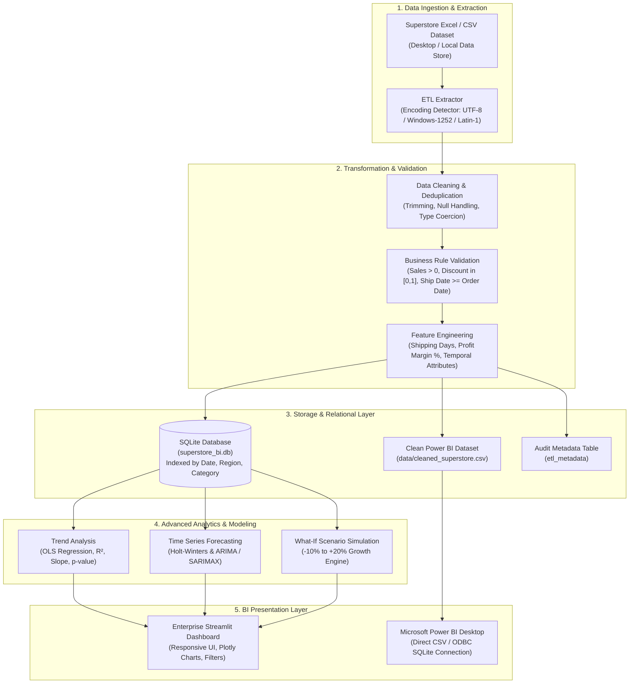
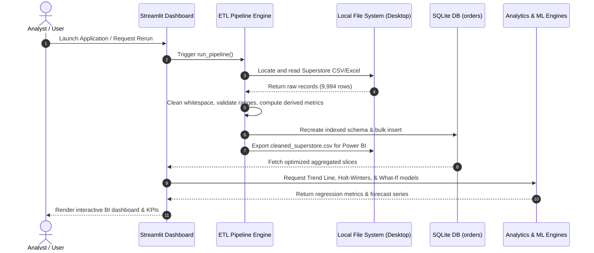

# System Architecture & Technical Design

## 1. High-Level System Architecture

## 2. Sequence Diagram (ETL Execution Flow)

## 3. Database Schema (`superstore_bi.db`)

### Table: `orders`
| Column | Type | Description |
|---|---|---|
| `row_id` | INTEGER PRIMARY KEY | Unique surrogate identifier |
| `order_id` | TEXT | Unique transaction code (e.g., CA-2016-152156) |
| `order_date` | TEXT (ISO 8601) | Date of purchase (YYYY-MM-DD) |
| `ship_date` | TEXT (ISO 8601) | Date of fulfillment (YYYY-MM-DD) |
| `ship_mode` | TEXT | Fulfillment tier (Standard, Second Class, etc.) |
| `customer_id` | TEXT | Unique customer reference |
| `customer_name` | TEXT | Customer display name |
| `segment` | TEXT | Consumer / Corporate / Home Office |
| `country` | TEXT | Country jurisdiction (United States) |
| `city` | TEXT | City name |
| `state` | TEXT | State / Province |
| `postal_code` | TEXT | Formatted 5-digit postal code |
| `region` | TEXT | Geographic region (West, East, Central, South) |
| `product_id` | TEXT | Unique product inventory SKU |
| `category` | TEXT | Top-level merchandise division |
| `sub_category` | TEXT | Granular merchandise segment (17 classes) |
| `product_name` | TEXT | Full item description |
| `sales` | REAL | Total transaction sales value |
| `quantity` | INTEGER | Units purchased |
| `discount` | REAL | Commercial discount rate [0.0 - 0.8] |
| `profit` | REAL | Net transactional profit (positive or negative) |
| `shipping_days` | INTEGER | Elapsed days between order and dispatch |
| `order_year` | INTEGER | Calendar year extracted from order date |
| `order_month` | INTEGER | Calendar month number (1 - 12) |
| `order_month_name` | TEXT | Abbreviated month name (Jan - Dec) |
| `order_quarter` | TEXT | Fiscal quarter (Q1 - Q4) |
| `year_month` | TEXT | Year-month temporal index (YYYY-MM) |
| `profit_margin_pct`| REAL | Calculated as (Profit / Sales) * 100 |
| `unit_price` | REAL | Calculated as Sales / Quantity |
| `is_profitable` | INTEGER | Boolean flag: 1 if Profit > 0 else 0 |

### Indexes Built:
- `idx_orders_order_date` on `order_date`
- `idx_orders_region` on `region`
- `idx_orders_category` on `category`
- `idx_orders_sub_category` on `sub_category`
- `idx_orders_year_month` on `year_month`
- `idx_orders_customer` on `customer_id`
- `idx_orders_product` on `product_id`
